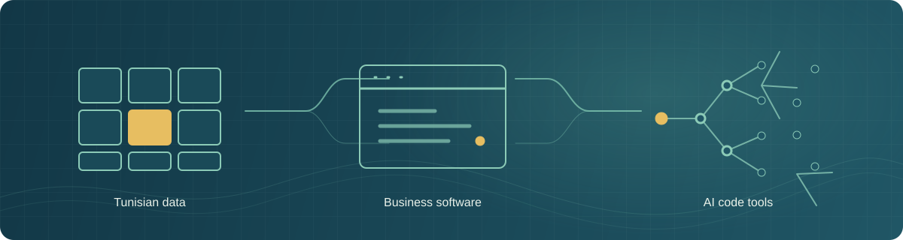

  

# Alaa Taieb

**Full-stack developer and product builder based in Tunisia.**

The problem might be a Tunisian data format, a local business workflow, or an AI agent trying to understand a codebase. I build across the stack to turn problems like those into usable software.

[Portfolio](https://www.alaataieb.com/) · [LinkedIn](https://www.linkedin.com/in/alaa-taieb/) · [X](https://x.com/alaa_taieb)

## Projects

| Project | What it does |
| --- | --- |
| [**Open-Codemap**](https://github.com/Alaa-Taieb/Open-Codemap) | Indexes a codebase locally and gives AI agents structural context through code chunks and call/import relationships. |
| [**TunisiaKit**](https://github.com/Alaa-Taieb/tunisia-kit) | TypeScript utilities for validating and formatting Tunisian data, with local reference data. |
| [**Agentic Coding Standard CLI**](https://github.com/Alaa-Taieb/agentic-std) | Scaffolds an `.agent/` directory to give coding agents consistent project context. |
| [**LLM Web Interface**](https://github.com/Alaa-Taieb/LLM-Web-Interface) | A React and Node.js chat interface built around streaming model responses and API-key management. |

## Background

I’ve taught full-stack web development and worked with clients through CodePal. I hold a bachelor’s degree in Web Development.

## Tools I work with

- **Core stack:** TypeScript, React, Node.js, Python
- **Focus:** APIs, developer experience, performance, accessibility, and AI/agent tooling
