<a href="https://www.alaataieb.com/">
  <picture>
    <source media="(prefers-color-scheme: dark)" srcset="assets/dark/hero.svg">
    
  </picture>
</a>

<picture>
  <source media="(prefers-color-scheme: dark)" srcset="assets/dark/stats.svg">
  
</picture>

  <a href="https://www.alaataieb.com/"><b>alaataieb.com</b></a> &nbsp;·&nbsp;
  <a href="https://www.linkedin.com/in/alaa-taieb/">LinkedIn</a> &nbsp;·&nbsp;
  <a href="https://x.com/alaa_taieb">X</a> &nbsp;·&nbsp;
  <a href="mailto:alaataieb.tn@gmail.com">alaataieb.tn@gmail.com</a>

## Open source

<a href="https://github.com/Alaa-Taieb/map-tunisia">
  <picture>
    <source media="(prefers-color-scheme: dark)" srcset="assets/dark/map-tunisia.svg">
    
  </picture>
</a>

<a href="https://github.com/Alaa-Taieb/tunisia-kit"><picture><source media="(prefers-color-scheme: dark)" srcset="assets/dark/tunisia-kit.svg"></picture></a> <a href="https://github.com/Alaa-Taieb/Open-Codemap"><picture><source media="(prefers-color-scheme: dark)" srcset="assets/dark/open-codemap.svg"></picture></a>
<a href="https://github.com/Alaa-Taieb/element-lens"><picture><source media="(prefers-color-scheme: dark)" srcset="assets/dark/element-lens.svg"></picture></a> <a href="https://github.com/Alaa-Taieb/agentic-std"><picture><source media="(prefers-color-scheme: dark)" srcset="assets/dark/agentic-std.svg"></picture></a>

## In the workshop

<picture>
  <source media="(prefers-color-scheme: dark)" srcset="assets/dark/workshop.svg">
  
</picture>

## Shipped

| Project | What it is | Built with |
| --- | --- | --- |
| [**Djerba Confort**](https://www.alaataieb.com/projects/djerba-confort-management-system) | Operations console for a bus company: routes, schedules, ticket sales, refunds and reporting | React · Node.js · PostgreSQL |
| [**Flux Convert**](https://flux-convert.xyz) | File converter with 254+ conversion types that runs in the browser, so files never leave the device | Next.js · TypeScript · WebAssembly |
| [**Safa Djerba**](https://dar-jerba.online) | Bilingual Arabic and French booking site for holiday apartments in Djerba | Next.js · SQLite |
| [**Boura Flower Shop**](https://www.alaataieb.com/projects/boura-flower-shop) | Florist storefront with a filterable catalogue, cart and multi-language support | React · TypeScript |

## By the numbers

<picture>
  <source media="(prefers-color-scheme: dark)" srcset="assets/dark/activity.svg">
  
</picture>

<picture>
  <source media="(prefers-color-scheme: dark)" srcset="assets/dark/languages.svg">
  
</picture>

<picture>
  <source media="(prefers-color-scheme: dark)" srcset="assets/dark/path.svg">
  
</picture>

Every number above comes from the GitHub, npm and PyPI APIs. <code>node scripts/build.mjs</code> redraws the artwork from <a href="data/profile.json">data/profile.json</a>. The map is drawn from <a href="https://github.com/Alaa-Taieb/map-tunisia">Map Tunisia</a>; map data © OpenStreetMap contributors (ODbL).
